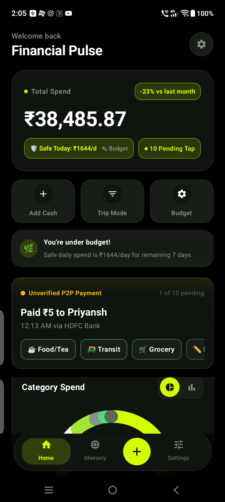
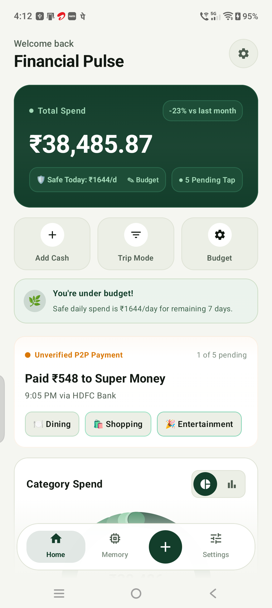
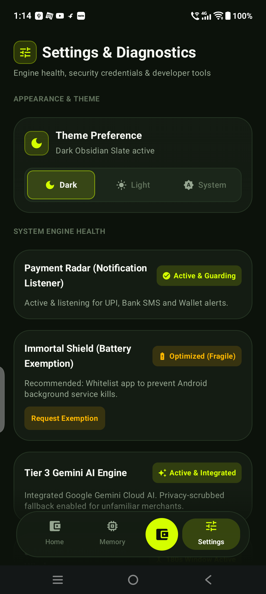
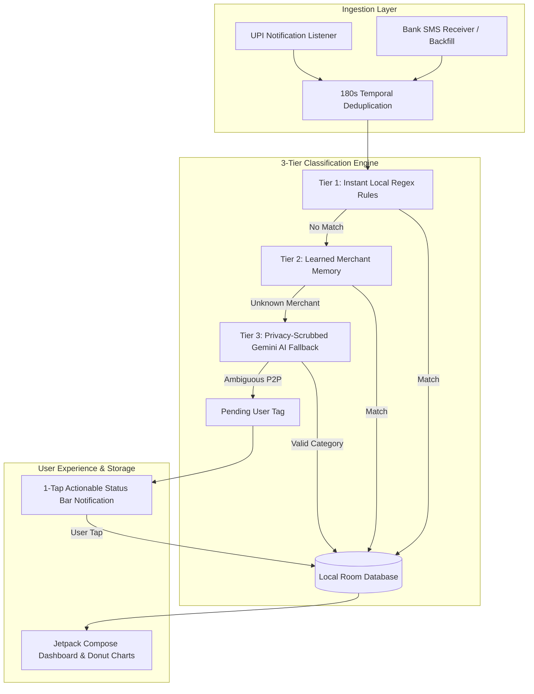

<div align="center">

  

  # SpendLog

  **Private, Automated Personal Finance & Expense Tracker for Android**

  [](https://developer.android.com)
  [](https://kotlinlang.org)
  [](https://developer.android.com/jetpack/compose)
  [-orange.svg)](https://developer.android.com/training/data-storage/room)
  [](https://ai.google.dev)
  [](#-privacy--zero-cloud-guarantee)
  [](LICENSE)

  <p>
    An intelligent, privacy-first personal finance tracker engineered for India's <b>UPI, SMS, and Banking</b> ecosystem.<br />
    Detects transactions in real time, organizes expenses with a 3-tier classification engine, and delivers a sleek Dark Fintech aesthetic without third-party chart dependencies or server-side data leaks.
  </p>

</div>

---

## ✨ Features

- **⚡ Instant Real-Time Payment Radar:** Ingests payments in milliseconds from UPI apps (Google Pay, PhonePe, Paytm, CRED, BHIM) and bank notification alerts without needing to open the app.
- **🛡️ 100% On-Device Privacy:** All SMS parsing and categorization logic executes locally on your phone. No bank logins, no NetBanking credentials, and no external servers tracking your finances.
- **🎯 3-Tier Classification Engine:**
  1. *Tier 1 (Instant Regex):* Deterministic sub-millisecond regex parsing for all major Indian banks (HDFC, SBI, ICICI, Axis, Kotak, etc.) and merchants.
  2. *Tier 2 (Merchant Memory):* Learns your personal vendor tags permanently in local SQLite Room memory.
  3. *Tier 3 (Privacy-Scrubbed Gemini AI):* Intelligent fallback for unfamiliar merchants. Stricly strips raw SMS, account suffixes, and closing balances before querying Google Gemini Flash.
- **⏱️ 180s Temporal Deduplication:** A sliding time buffer prevents double-counting when concurrent Bank SMS and UPI push notifications arrive for the same transaction.
- **👆 1-Tap Actionable Notifications:** Categorize unverified payments or split bills directly from the Android system notification tray without switching apps.
- **📊 Native Compose Canvas Charts:** Built with 100% native Compose Canvas drawing and Animatable state transitions (zero external chart library dependencies or JitPack resolution hazards).
- **🎨 Dark Fintech Craft Design:** Curated palette featuring Obsidian Slate (`#090D16`), Emerald Neon (`#10B981`), Crimson Coral (`#F43F5E`), and Glowing Amber (`#F59E0B`), complete with seamless Light and Dark mode transitions.
- **🔄 30-Day Historical Backfill:** Optional background scan through Android `WorkManager` to import and reconcile transactions from the past month.

---

## 📸 Screenshots

| Dark Fintech Mode | Light Fintech Mode | Settings & System Diagnostics |
|:---:|:---:|:---:|
|  |  |  |

---

## 🏛️ System Architecture



---

## 🔒 Privacy & Zero-Cloud Guarantee

SpendLog is built on an uncompromising privacy foundation:

1. **Strict Data Scrubbing:** Raw SMS bodies, bank account numbers (`A/c XX1234`), debit card numbers, and closing balances **never** leave your device.
2. **Scrubbed AI Payload:** In the rare case Gemini AI is invoked for unfamiliar merchant names, only `{ rawMerchant, upiVpaPrefix, hourOfDay, amount }` is transmitted.
3. **P2P Zero-Guessing Rule:** If a payment payee is an ambiguous human name without business keywords (e.g. "Ramesh Kumar"), SpendLog never guesses. It routes the transaction to `Pending User Tap` so you maintain 100% control over your financial records.
4. **Offline Resilience:** If you do not configure an API key, the app continues to operate with 100% functionality using local Regex rules and learned merchant memory.

---

## 🛠️ Tech Stack & Architecture

- **Language:** Kotlin 2.0 (Targeting Android 16 / SDK 36, Min SDK 24)
- **UI Toolkit:** Jetpack Compose with Material 3 exclusively
- **Database:** SQLite via AndroidX Room with Google KSP (`com.google.devtools.ksp`) annotation processing
- **Concurrency:** Kotlin Coroutines & Asynchronous Flow
- **Background Work:** AndroidX WorkManager (Scheduled historical sync)
- **Typography:** Tabular figures (`tnum`) for animated currency digits without UI jitter
- **Architecture:** Clean Architecture with Unidirectional Data Flow (MVI/MVVM pattern)

---

## 🚀 Getting Started

### Prerequisites
- [Android Studio Ladybug (2024.2.1+)](https://developer.android.com/studio)
- JDK 17+
- Android SDK 36 (Android 16 Developer Preview or Android 14/15 physical device/emulator)

### 1. Clone the Repository
```bash
git clone https://github.com/YOUR_USERNAME/SpendLog.git
cd SpendLog
```

### 2. Configure Local Properties
Copy the template configuration file:
```bash
cp local.properties.example local.properties
```

Edit `local.properties` to specify your Android SDK directory and (optional) Gemini API key:
```properties
sdk.dir=/Users/YOUR_USERNAME/Library/Android/sdk

# Optional: Google Gemini API key for Tier-3 fallback categorization
# Get a free key at: https://ai.google.dev
gemini.api.key=YOUR_GEMINI_API_KEY_HERE
```
> **Note:** If `gemini.api.key` is omitted, the app will compile and function normally using local regex and merchant memory. You can also configure the API key anytime inside the app under **Settings → Tier 3 Gemini AI Engine**.

### 3. Build & Install
To build the debug APK:
```bash
./gradlew assembleDebug
```

To install directly to a connected device:
```bash
./gradlew installDebug
```

To build an optimized, standalone release APK:
```bash
./gradlew assembleRelease
```
The output APK will be located at `app/build/outputs/apk/release/app-release.apk`.

---

## 🔑 Permissions Breakdown

| Permission | Purpose | Privacy Enforcement |
|:---|:---|:---|
| `BIND_NOTIFICATION_LISTENER_SERVICE` | Real-time UPI notification ingestion | Filtered strictly by package IDs for verified banking apps. |
| `READ_SMS` & `RECEIVE_SMS` | Historical 30-day transaction backfill & SMS capture | Parsed locally via Regex; sensitive card/balance data strictly discarded. |
| `POST_NOTIFICATIONS` | 1-Tap actionable tagging for pending transactions | Local notifications only; no promotional or marketing pushes. |
| `REQUEST_IGNORE_BATTERY_OPTIMIZATIONS` | Ensures notification listener is not killed by OEM battery savers | Optional toggle with settings guidance in Onboarding. |
| `INTERNET` | Optional fallback merchant category lookup via Google Gemini API | Only scrubbed merchant strings transmitted; never raw financial records. |

---

## 📄 License

This project is licensed under the MIT License - see the [LICENSE](LICENSE) file for details.
